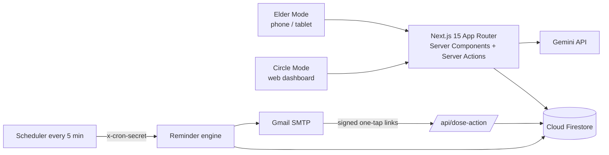

# MedSaathi

**Dawa time pe, parivaar saath mein.** An elder-first medication and care platform: the family helps, the elder decides.

Built for the PromptWars x Catalyst challenge "Elderly Care & Medication Management Platform".

- **Live demo:** https://medsaathi-three.vercel.app
- **Demo family:** Care Code `482915`, elder PIN `1234` (or tap **See Baba's view** / **See Rahul's view** on the home page)

## The idea

Most reminder apps treat the elderly person as someone to be managed. MedSaathi keeps them in charge:

| Problem statement asks for | How MedSaathi does it |
|---|---|
| Shared ecosystem for elder, caretakers and family | One profile, two interfaces: **Elder Mode** (large text, one action at a time) and **Circle Mode** (family dashboard) |
| Secure, passcode-based access | 6-digit **Care Code** + personal PIN/passcode, bcrypt hashed, lockout after 5 wrong tries, signed httpOnly session cookies |
| View, add, edit and manage medication schedules | Type the prescription the way Indian doctors write it (`1-0-1`, after food) and it becomes a schedule. Or **scan the prescription with Gemini** |
| Track adherence | 30-day dose calendar, on-time / late / missed, patterns ("afternoon doses are missed most") and skip reasons |
| Monitor upcoming appointments | Visits with "who is taking them", carry checklist, questions for the doctor, Google Calendar and Google Maps links |
| Email reminders for missed meds, upcoming doses and appointments | An **escalation ladder**: heads-up to the elder, nudge at dose time, primary caretaker after 30 min, whole circle after 60 min. Appointment reminders 24 h and 2 h before. One-tap **"Mark as taken" / "Snooze"** buttons inside the email |
| Go beyond a basic reminder app | **Elder approval** for every family change, **read-aloud in Hindi and English**, **one-tap WhatsApp daily update** for the family, **installable as a phone app**, skip reasons, refill countdown, daily mood check-in, Gemini doctor summary, hold-for-help button, emergency card |
| Elder at the centre of decisions | Only the elder can approve new members, choose their role and accept medicine changes. Every change is in the activity log with who made it |

## Try it

- Home page → **See Baba's view** opens Elder Mode. Tap **सुनिए / Read aloud** to hear the dose in Hindi or English.
- Home page → **See Rahul's view** opens Circle Mode. Tap **Send today's update on WhatsApp** for a ready-made family message.
- Circle Mode → **Reminders** → **Try a missed-dose email** sends the real reminder email.
- Family login: `rahul.demo@medsaathi.app`, passcode `2468`.
- On a phone, use the browser's **Add to Home screen** to install MedSaathi as an app.

## Evaluation checklist

| Criterion | What we did | How to check |
|---|---|---|
| **Problem statement alignment** | Every requirement above is implemented end to end, with real email delivery and a live scheduler | Live demo, table above |
| **Code quality** | TypeScript strict mode, ESLint (Next.js core web vitals), small pure modules for all business logic, zod schemas on every server action | `npm run typecheck`, `npm run lint` (0 warnings) |
| **Security** | bcrypt PINs, lockout after 5 tries, signed httpOnly sessions, signed 12-hour email tokens, timing-safe cron secret, HTML-escaped emails (text and links), profile scoping on every read and write, strict security headers, Firestore client access denied, 0 known vulnerabilities | `npm audit --omit=dev` (0 vulnerabilities), `tests/security.test.ts` |
| **Testing** | 44 Vitest tests over 7 files: prescription parsing, escalation ladder, adherence, permissions, IST time maths, token tampering/expiry/wrong-secret, email escaping, read-aloud text, WhatsApp message | `npm test` |
| **Accessibility** | Atkinson Hyperlegible font, 20px+ text and 64px buttons for elders, Hindi/English read-aloud, status always icon + word, skip link, labelled inputs, `aria-live` feedback, visible focus rings, `lang` on Hindi text, all animations off under `prefers-reduced-motion` | Keyboard and screen reader through any page |
| **Efficiency** | Server Components by default, client JS only where needed, optimised responsive images, functions pinned to Mumbai (`bom1`) next to Firestore, idempotent reminder engine safe to run every 5 minutes | `vercel.json`, `lib/reminders.ts` |
| **Google services** | Cloud Firestore, Gemini API, Gmail, Google Calendar and Google Maps links (details below) | `lib/db.ts`, `lib/gemini.ts`, `lib/email.ts` |

## Google services used

- **Cloud Firestore** for all data (server-only access through the Admin SDK, client access denied by `firestore.rules`)
- **Gemini API** (`@google/genai`) for prescription photo reading with a JSON response schema, and the doctor visit summary
- **Gmail SMTP** for reminder delivery
- **Google Calendar** and **Google Maps** deep links for every appointment
- Works with **Google Cloud Scheduler** (or cron-job.org) to trigger `/api/cron/reminders`

## Architecture



```
app/
  (pages)          landing, login, join, start, done
  elder/           Elder Mode: today, skip reason, approvals, check-in, doctor, family
  circle/          Circle Mode: dashboard, medicines, appointments, adherence, members, reminders, activity, emergency
  actions/         server actions (auth, care, ai), all validated with zod
  api/             cron trigger and one-tap email actions
  manifest.ts      installable web app manifest
lib/
  prescription.ts  1-0-1 parser and stock maths            (pure, tested)
  escalation.ts    reminder ladder decisions                (pure, tested)
  adherence.ts     dose expansion, adherence report         (pure, tested)
  permissions.ts   role matrix, elder approval rule         (pure, tested)
  time.ts          IST handling on UTC servers              (pure, tested)
  voice.ts         read-aloud text in Hindi and English     (pure, tested)
  share.ts         WhatsApp daily update message            (pure, tested)
  session.ts       signed sessions and email tokens         (tested)
  email.ts         Gmail delivery and escaped email layout  (tested)
  db.ts            Firestore store with in-memory fallback
  reminders.ts     reminder engine, emails, calendar links
  gemini.ts        Gemini prescription reader and summary
tests/             Vitest unit tests
```

## Design decisions

- **Elder approval instead of silent edits.** Family members can suggest; only the elder applies. This is the single biggest difference from a reminder app.
- **Missed is information, not failure.** Skips ask "why" (forgot, unwell, ran out, side effects). Reasons feed the adherence patterns and the doctor summary.
- **Escalation, not spam.** Each step is recorded on the dose, so the engine is idempotent and safe to run every few minutes. Doses older than 6 hours are never emailed about.
- **Speak their language.** Elders with low vision or limited reading can hear each dose in Hindi or English, using the phone's built-in voice (no extra service or key).
- **Meet families where they are.** Indian families coordinate on WhatsApp, so the daily summary is one tap away.
- **IST everywhere.** Servers run on UTC; all schedule maths goes through `lib/time.ts`.

## Run locally

```bash
npm install
cp .env.example .env.local   # all keys optional for local use
npm run dev
npm test          # 44 tests
npm run lint
npm run typecheck
```

Without Firebase keys the app uses an in-memory store with the demo family. Without Gmail keys emails are recorded in the in-app outbox.

## Deploy (Vercel)

1. Import the repo in Vercel. `vercel.json` pins functions to Mumbai (`bom1`), close to an `asia-south1` Firestore.
2. Add environment variables from `.env.example` (`SESSION_SECRET`, `CRON_SECRET`, `APP_URL`, Firebase, Gmail, Gemini).
3. Create a free job on cron-job.org (or Cloud Scheduler) that calls `https://<your-app>/api/cron/reminders` every 5 minutes with header `x-cron-secret: <CRON_SECRET>`.
4. Publish `firestore.rules` in the Firebase console.
